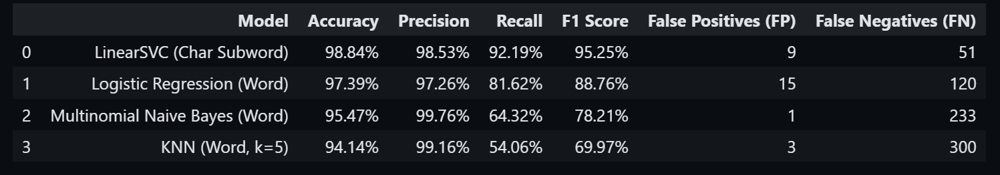

# Phone_SMS_Spam_Detector

## Important Files

Start with these files to understand the project:

| File | Purpose |
| --- | --- |
| `website` | Code for website. |
| `model_linearsvc.joblib` | Trained LinearSVC model used by the machine-learning detector. |
| `*.joblib files` | Weights for the detecting models |
| `Basic_Demo.py` | Demo of the detector in the terminal. |
| `predict_live.py` | Simple script for testing predictions from the trained model. |
| `clean_data.py` | Cleaned dataset combined from multiple open-source SPAM & HAM SMS datasets. |
| `model_comparison.ipynb` | Jupyter Notebook used to evaluate the machine-learning models. |

## How to Use This Repository

This project detects whether an SMS message is spam using three methods: keyword rules, point scoring, and a trained LinearSVC machine-learning model.

### 1. Download the repository

```bash
git clone https://github.com/main-cpp-de-anza/Phone_SMS_Spam_Detector.git
cd Phone_SMS_Spam_Detector
```

### 2. Create a Python environment

Python 3.10 or newer is recommended.

```bash
python -m venv .venv
```

Activate it on Windows:

```powershell
.\.venv\Scripts\Activate.ps1
```

Activate it on macOS or Linux:

```bash
source .venv/bin/activate
```

### 3. Install the dependencies

```bash
pip install -r website/requirements.txt
```

### 4. Run the interactive website

```bash
python website/app.py
```

Open [http://127.0.0.1:8000](http://127.0.0.1:8000) in your browser. Enter an SMS message, or choose one of the preset examples, and click **Analyze Message**.

### 5. Run the command-line demo

To compare the three detection methods in the terminal, run:

```bash
python Basic_Demo.py
```

The trained model file `model_linearsvc.joblib` must remain in the repository root for the machine-learning detector to work.


## Datasets 

* [UCI SMS Spam Collection](https://archive.ics.uci.edu/dataset/228/sms+spam+collection)
* [Mendeley SMS Phishing Dataset](https://data.mendeley.com/datasets/f45bkkt8pr/1)
* [Smishtank Phishing Corpus (SMISH_DT)](https://smishtank.com/dataset)
* [IMC 2025 ACM Smishing Dataset](https://github.com/reportsmishing/Smishing-Dataset-IMC25)
* [NUS SMS Corpus](https://github.com/kite1988/nus-sms-corpus)

---

## Data Cleaning

### Cleaning Steps:
* **lowercase**: converts all letters to lowercase.
* **links**: replaces websites, domains, and shortened links with `[url]`.
* **money**: replaces currency symbols, amounts, and phrases (`$500`, `1k`, `1 million dollars`) with `[money]`.
* **phone numbers**: replaces phone numbers and shortcodes with `[phone]`.
* **numbers**: replaces standalone numbers with `[number]`.
* **spaces**: removes extra whitespaces and strips edges.
* **remove duplicates**: drops exact duplicate texts.

---

### Before vs After Cleaning Examples

#### Example 1: Lottery / Prize Scam
* **Before:**
  ```text
  CONGRATULATION, you just won $500 cash! Visit bit.ly/claim or call 800-555-0199 now!
  ```
* **After:**
  ```text
  congratulation, you just won [money] cash! visit [url] or call [phone] now!
  ```

#### Example 2: Package Delivery Scam (Smishing)
* **Before:**
  ```text
  USPS alert: Your package is stuck at transit. Pay 15 dollars fee at https://usps-redelivery.com/pay
  ```
* **After:**
  ```text
  usps alert: your package is stuck at transit. pay [money] fee at [url]
  ```

#### Example 3: Normal Message (Ham)
* **Before:**
  ```text
  Hey Mom, are we meeting for lunch at 12:30 tomorrow?
  ```
* **After:**
  ```text
  hey mom, are we meeting for lunch at [number]:[number] tomorrow?
  ```
## Model Comparison



LinearSVC has higest Accuracy (98.84%) and F1 Score (95.25%), missing 51 spam messages compared to 120 (Logistic), 233 (Naive Bayes), and 300 (KNN).
